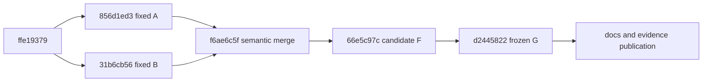

# File backend safety integration: frozen G delivery

Status: **PARTIAL**. Task label 20261026; final execution continued on 2026-10-27
Asia/Shanghai. All results below belong to the same immutable G source, with
fresh independent copies. Earlier candidate scores are not transferred or added.

## Answers and remaining acceptance gaps

1. Budget/strict-read safeguards and original lifecycle/writer protections passed
   together on G in the groups below, including original mounted assembly and
   real loopback HTTP. This is a File backend integration result, not all Studio.
2. No stable loss of the original guarantees was found in G's selected regressions.
   Candidate F's first parallel asset regression run had 37 refusals (155 passed).
   They are **unexplained, not fixed by this work**: separate A/F diagnostics and
   G's full original 192-case run passed. Keep this uncertainty open; a later
   pass is not proof of a repair or load-independent reliability.
3. Full actual-payload budgeting covers explicitly paginated asset usage File GET
   requests, from outer authorization through identity/scope/grants/project,
   asset and consumer reads, reauthorization, repeated reads and final checks.
   Original byte-exact Store snapshot/CAS rereads also charge an active budget.
   Export's original reader participates only when a budget is already active.
   TaskCenter HTTP, legacy no-page calls, unrelated routes, metadata syscalls,
   lock wait, and PostgreSQL prefetch have no new universal budget claim.
4. Strict reads and legitimate original writers coexist in the tested Windows
   cases: initialized strict operations create/write no facilities; missing ones
   refuse 409. Compatible mode retains original lock initialization, measured
   separately from business writes. Context/lock exceptions and subsequent
   ordinary/other-thread writes, process termination and reopen were exercised.
5. The existing Windows asset-list cursor still returns 503. Positive collaborative
   Asset + TaskCenter TCP in one Host configuration remains NOT_COVERED: the
   original development-session Asset GET correctly refuses Host authority.
   POSIX, PostgreSQL, browser/frontend, real model/GPU and hosted CI are NOT_RUN.
   No hard RSS/CPU/lock-wait, complete ABA, cross-owner atomic snapshot,
   exclusive active worker or persistent cross-worker cursor promise is added.

## Fixed inputs, integration and recovery points

| Point | Commit | Tree |
| --- | --- | --- |
| A | `856d1ed3341fe0c24df1daff9a8bc1242c260e6c` | `d6c8057a0595d93eab6d3799787226faf660e834` |
| B | `31b6cb56ba3d2fa08719cf917c2c75ee8f168c8f` | `fc6f7e5510313e0e334b07efaae99127a895d568` |
| Core ordinary two-parent merge | `f6ae6c5fb2bda8b875bdbd1f32b5bafd18d9d070` | `0f1319ce8be5e6ede3d5e6a23399f5d776aedb3d` |
| Accepted source/test/script freeze G | `d24458225be78f3cbe804b2e325a2f02c3e95568` | `f17fe2b160606c660bca6c0d400c21aff29b30ef` |

Merge-base `ffe1937911cff32d4ebd4770b350674627501d3a`; repository was not shallow. Both designated rebuild/Export
commits were already ancestors of B and were not reapplied. No later input ref
was silently adopted. Publication uses only the new branch
`work/file-backend-safety-integration-20261026`. Later delivery commits contain
docs/evidence only and must have zero diff in app/tests/scripts from G.

See [actual graph](integration-graph.txt), [all actual file differences](actual-file-diff.tsv),
[production patch](production-diff.patch), [file/symbol conflict and owner chains](M1_INTEGRATION.md),
[implementation notes](CORE_NOTES.md), [static coverage limits](LIMITS.md),
[executor/history gate](M0_EXECUTION.md), and [Hermia's future interface contract](HERMIA_HANDOFF.md).
Production ownership stayed with one 6astra integrator; other 6astra agents owned
HTTP and independent tests. Frontend/SDK and A/B/main/BOT branches were untouched.

## Frozen validation (overlapping groups are not a unique total)

Each receipt records exact arguments, source identity/hashes before and after,
loaded module paths, process exit, elapsed time and hard timeout state. All pass
rows exited 0 and had unchanged source; no JUnit-only completion is credited.

| Group | Result | Process seconds | Exact receipt |
| --- | --- | --- | --- |
| asset-regressions | 192 passed | 168.73 | [receipt](coordinator-final-G/asset-regressions.receipt.json) |
| resource-core | 122 passed | 18.22 | [receipt](coordinator-final-G/resource-core.receipt.json) |
| taskcenter-lifecycle | 386 passed | 51.28 | [receipt](coordinator-final-G/taskcenter-lifecycle.receipt.json) |
| export-consumers-corrected | 99 passed, 2 skipped | 27.58 | [receipt](coordinator-final-G/export-consumers-corrected.receipt.json) |
| windows-process | 26 passed | 32.99 | [receipt](coordinator-final-G/windows-process.receipt.json) |
| asset-independent-existing | 90 passed | 129.63 | [receipt](coordinator-final-G/asset-independent-existing.receipt.json) |
| resource-measurements | 4 passed | 39.57 | [receipt](coordinator-final-G/resource-measurements.receipt.json) |
| original-scale-loopback | 2 passed | 221.51 | [receipt](coordinator-final-G/original-scale-loopback.receipt.json) |
| new-independent | 23 passed | 11.12 | [receipt](independent/final-G-d2445822/receipt.json) |
| combined-TCP-HTTP | 4 passed | 221.44 | [receipt](http/final-G-d2445822/frozen-http-G.receipt.json) |

The two Export skips are POSIX SIGKILL-only cases: NOT_RUN on Windows. Windows
TerminateProcess evidence is the separate 26-case group, including all six
original owner categories, before/after replace, failures, reopen and real locks.
The scale group emitted a diagnostic faulthandler stack at its 120-second probe;
this did not terminate it. Its 900-second process timeout was false, and the
actual process exited 0 after both tests. Raw output is retained.

The [independent report](independent/REPORT.md) and [G TCP report](http/final-G-d2445822/REPORT.md)
are separate attestations. Ten original-app child processes completed 142 GETs:
observed commands 0, business writes 0, strict writes/file/directory creations 0.
Compatible original coordinator initialization wrote its lock byte twice.
Deterministic stub exporters ran only for the legitimate POST-created fixture
jobs (three per local normal process). GET never invoked those executors.
Both budget-failure processes read 2528 actual bytes then returned 409 at a test
cap of 4096; no partial private page or successful empty page was returned.

Three TaskCenter single-source combinations were retained independently:
File/local semantic_import, File/local exports, and File/collaboration agent_team
in the original no-chapter/source window. Mixed and collaboration exports remain
explicit refusals. Local same-project writes → strict/ordinary asset queries →
both local task cursors → lifecycle invalidation → restart/reopen all used the
same integrated original assembly. The original legacy envelopes/error order,
UNKNOWN/NOT_ASSERTED coverage, Export public map/idempotency/recovery and private
same-file metadata are covered by the cited groups.

## Resource observations and coverage

All 17 independently metered request observations reconcile actual payload bytes
to one fresh charged budget. No product counter alone is used as evidence.
Four real File authority-chain samples each read 1,931 times / 3,301,579 bytes;
the checks were retained, not cached or removed. Small fixture first pages read
389 times, continuation/replay 420 times. Input JSON limits and binary integrity
are distinct from whole-process resource limits.

Preserved admission values are 8,192 file attempts and 256 MiB actual payload
per request; JSON files admit at most 4 MiB (with original narrower owner limits,
including 1 MiB asset metadata and the 256-byte incarnation marker), binary
integrity input at most 25 MiB, depth 64, encoded string 256 KiB, encoded scalar
1,024 bytes, 100,000 tokens per document and 64,000,000 tokens per request.
The 30-second deadline is checked at boundaries; it is not a hard CPU or lock
wait timer. The 64-entry shape cache keeps digests/counts, never permissions or
decoded documents. Original per-page consumer/position/output limits remain.

| Synthetic request / phase | Actual read calls | Actual = charged bytes | Seconds | Python peak bytes |
| --- | --- | --- | --- | --- |
| combined-windows-memory.json / initialized_first | 389 | 250131 | 0.891 | 848394 |
| combined-windows-memory.json / continuation | 420 | 273730 | 0.961 | 877816 |
| combined-windows-memory.json / replay_continuation | 420 | 273730 | 0.994 | 903563 |
| combined-windows-memory.json / repeat_first | 389 | 250131 | 0.885 | 841817 |
| resource-costs-fresh-process.json / first_page | 389 | 250033 | 5.433 | 27995677 |
| resource-costs-fresh-process.json / continuation_page | 420 | 273622 | 0.926 | 641101 |
| resource-costs-fresh-process.json / repeat_continuation_page | 420 | 273622 | 0.926 | 448944 |
| resource-costs-fresh-process.json / repeat_first_page | 389 | 250033 | 0.852 | 453277 |
| resource-costs-initialized-http.json / first_page | 389 | 250033 | 0.901 | 515071 |
| resource-costs-initialized-http.json / continuation_page | 420 | 273622 | 0.941 | 635927 |
| resource-costs-initialized-http.json / repeat_continuation_page | 420 | 273622 | 0.935 | 476729 |
| resource-costs-initialized-http.json / repeat_first_page | 389 | 250033 | 0.848 | 463079 |
| resource-costs-real-authority.json / first_page | 1931 | 3301579 | 3.413 | 659650 |
| resource-costs-real-authority.json / continuation_page | 1931 | 3301579 | 3.372 | 654583 |
| resource-costs-real-authority.json / repeat_continuation_page | 1931 | 3301579 | 3.343 | 648247 |
| resource-costs-real-authority.json / repeat_first_page | 1931 | 3301579 | 3.351 | 656679 |
| resource-costs-schema3-binary.json / first_page_schema3 | 251 | 133329 | 0.511 | 436892 |

The fresh interpreter measurements start after original app import/startup;
OS caches were not cleared. The 5 ms Windows working-set sample ranged up to
242,257,920 bytes in this observed process, including setup/imports; sampling
can miss peaks. Lifetime working-set high-water marks remain in the raw
[metrics](metrics-final-G/combined-windows-memory.json). No per-request RSS bound,
speedup, whole cold-start bound or hard CPU/lock deadline follows from these data.

The fixed saved scale shape is 32 consumers / 540 references / six pages; Graph
copies exceeding the normal 25-create cap are labeled synthetic saved records.
The first and repeated traversals below are six separate request budgets each,
not one request. Largest page actual payload was 48,593,156 bytes; no business
writes occurred. Profiling and other validation add overhead.

| Traversal | Pages | Actual read calls | Actual bytes | Instrumented seconds | Largest Python peak |
| --- | --- | --- | --- | --- | --- |
| first-read-warm-os-cache | 6 | 11000 | 222835542 | 78.636 | 3919576 |
| repeat-read-warm-process | 6 | 11000 | 222835542 | 79.102 | 3807548 |

See [machine-readable results](verification-summary.json), [per-file/stage costs](metrics-final-G/),
and [raw scale data](scale-final-G/).

## Retained failures and platform boundaries

- [Known Windows asset-list receipt](coordinator-final-G/known-windows-asset-list.receipt.json)
  is a real exit-1 failure, matching [fixed-A baseline](http/baseline-A-asset-cursor.log).
  It is not included in passing usage-cursor totals and was not repaired here.
- [Candidate F failure](candidate-F/asset-regressions.receipt.json) and
  [diagnostics](owner-diagnostics/diagnostic-owner-summary.json) retain the
  unexplained 37 refusals and diagnostic import-order caveat. No speculative
  production or fixture fix was made for this event.
- [Fixed-B GBK diagnosis](independent/gbk-portability/REPORT.md) proves three
  original Windows test portability failures. Only explicit UTF-8 test I/O was
  corrected; default cp936 and production parsers remained in force. G reran
  all final groups; earlier F scores were not migrated.
- Development harness mistakes, deliberate test interruption, wrong first
  Export selector, native-code public error expectation, Event cleanup timeout,
  and HTTP instrumentation corrections remain under candidate/development
  evidence. They are not product passes or unexplained product defects.
- No Actions rerun, paid API, dependency installation, system/security/network/
  credential change, release or deployment was performed. GraphFlow indexing
  remains NOT_RUN because the exposed tools lacked the requested index API and
  the available context/planning transport closed. No successful refresh is claimed.

All newly archived payloads are source, tests or sanitized synthetic evidence.
Real projects, credentials and synthetic runtime data directories are excluded.
The Work shallow-history instruction is included verbatim in M0_EXECUTION.md.
